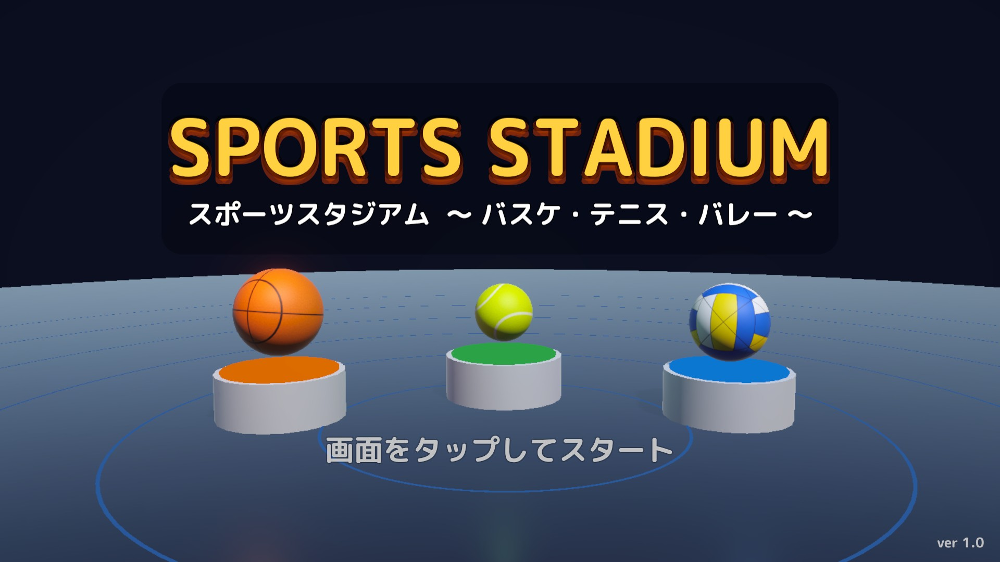
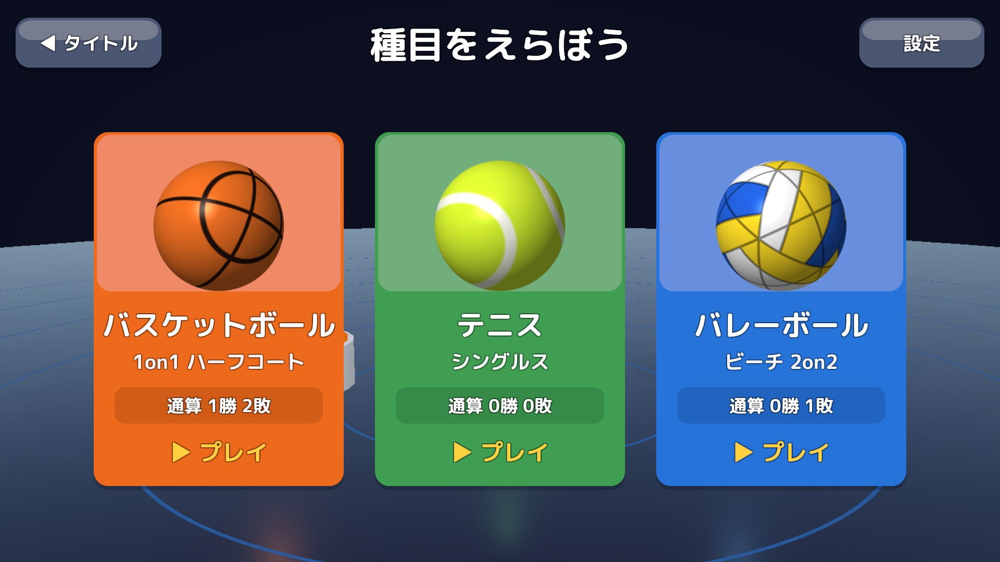
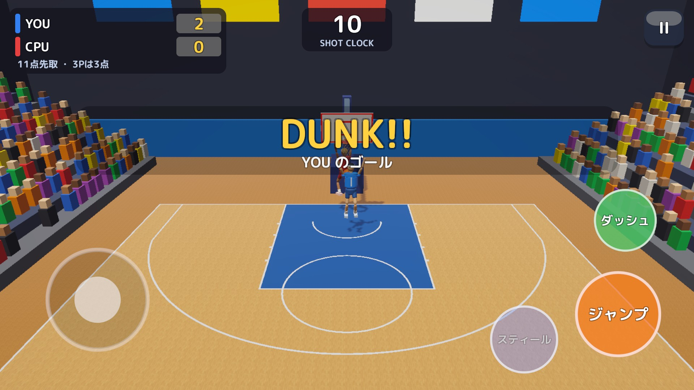
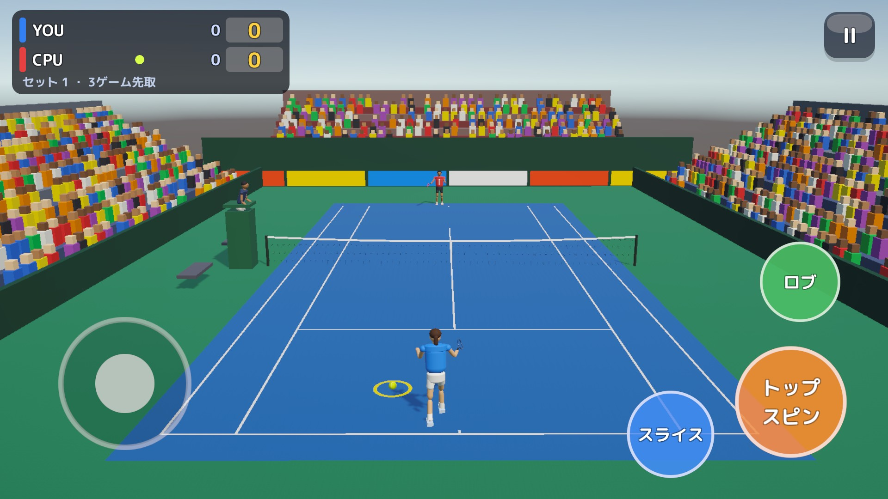
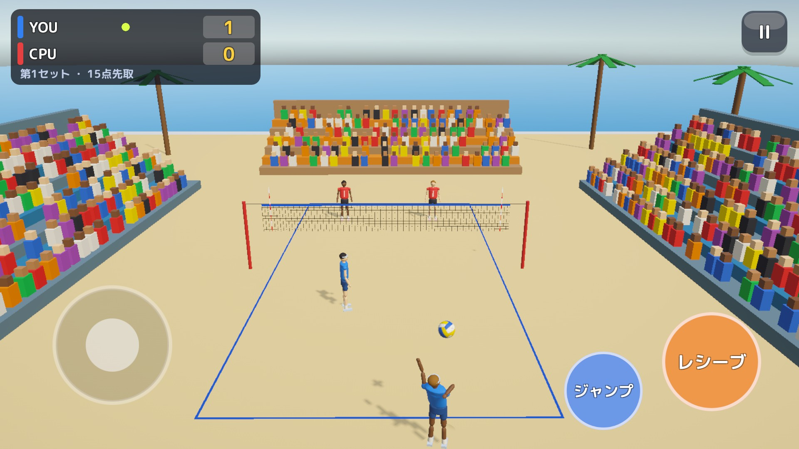
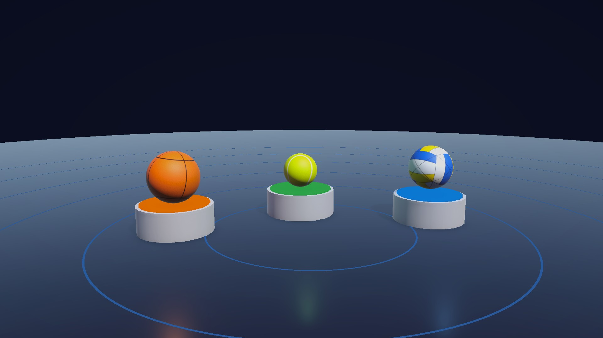

# スポーツスタジアム — 設計ドキュメント

> **バスケットボール・テニス・ビーチバレーを遊べる、スマホ向け（横画面）の 3D スポーツゲーム。**
> コート・キャラクター・テクスチャ・効果音・BGM を**すべて実行時に生成**し、ボール物理も自前で実装した（Unity 6 / C#）。

<table>
<tr>
<td width="33%"></td>
<td width="33%"></td>
<td width="33%"></td>
</tr>
<tr>
<td align="center">スタート</td>
<td align="center">種目選択</td>
<td align="center">バスケットボール（1on1）</td>
</tr>
<tr>
<td width="33%"></td>
<td width="33%"></td>
<td width="33%"></td>
</tr>
<tr>
<td align="center">テニス（シングルス）</td>
<td align="center">ビーチバレー（2on2）</td>
<td align="center">ボールも台座もコードで生成</td>
</tr>
</table>

## プロジェクト概要

| 項目 | 内容 |
|---|---|
| 種別 | スマートフォンゲーム（個人開発） |
| 対応 | Android / iOS（横画面）、Windows（動作確認済み） |
| 担当・進め方 | 企画・ゲームデザイン・UI・サウンド（合成）・テストを 1 人で担当。実装とドキュメント作成には生成 AI（Claude Code）を活用し、仕様決め・設計の判断・レビュー・テストでの検証は自分で行った |
| 開発時期 | 2026 年 10 月（コミットの記録: 10/20〜10/21） |
| 公開状況 | 未公開 |
| 規模 | C# 133 ファイル・約 11,000 行 ／ 4 シーン ／ 3 種目 ／ テスト 58 件 |

### 技術スタック

| 分類 | 技術 |
|---|---|
| エンジン / 言語 | Unity 6000.6 / C# |
| 描画 | URP 17.6（ポストエフェクト：トーンマッピング・ブルーム・色調補正・ビネット） |
| 入力 | Input System 1.20（タッチ・キーボード・ゲームパッドを統合） |
| UI | uGUI 2.6（コードで生成） |
| テスト | Unity Test Framework（EditMode・PlayMode） |
| ビルド | エディタ拡張のメニューから Android（IL2CPP / ARM64）・Windows・iOS |

---

## このプロジェクトで伝えたいこと

### 1. ボール物理を自前で作り、計算と動きを一致させた

Unity の物理エンジンに頼らず、**重力を解析解で積分する決定論的なボール物理**を実装しました。軌道計算（`BallMath`）と実際の動き（`BallSim`）が一致するので、

- CPU は `BallSim` を複製して先読みし（`BallPredictor`）、落下点へ走れる
- シュートは「成功率で成否を決め、成功ならリング中心へ・失敗ならリングに当たる位置へ投げる」ことで、**見た目は物理どおり、バランスは確率で制御**できる
- 「成功判定のシュートが物理的にも本当に入るか」を、距離と角度の組み合わせでテストしている

### 2. 3 種目を同じ設計で作った

各種目を「寸法・得点・審判・打球・操作・表示・調整値・進行」の 8 つの役割に分け、共通の土台（`MatchBase`）を継承しています。人の操作と CPU を同じインターフェース（`ITennisController` など）で扱うため、**両側を CPU にした自動対戦**でバランス調整やテストができます（→ [設計書 2 章](design.md#2-種目ごとの役割分担)）。

### 3. アセットを持たないゲーム

コート・ゴール・観客席のメッシュ、床やボールのテクスチャ、人型キャラクターとアニメーション、効果音と BGM まで、**すべてコードで生成**しています。外部アセットは日本語フォントだけです。プロジェクトのセットアップ（マテリアル・シーン・ビルド設定）もエディタのメニュー 1 つで自動化しました。

### 4. ルールの正しさと「最後まで遊べること」をテストで保証

テニスのデュース・タイブレーク、バレーのタッチ数やダブルタッチ、バスケのショットクロックとサドンデスなど、**競技のルールを EditMode テストで固定**しています。PlayMode テストでは 3 種目を実際に起動し、**難易度を変えて最後まで自動対戦させ、リザルト画面に到達する**ことを確認しています（エラーログが出たら失敗）。

### 5. スマホで遊びやすい操作

画面左のどこでも出るフローティングスティック、状況で変わるアクションボタン（攻撃時は「シュート」、守備時は「ブロック」など）、移動アシスト、省電力モード、バックグラウンドでの自動ポーズなど、スマホでの遊びやすさに配慮しています。

---

## 技術的な課題と解決

| 課題 | 解決 |
|---|---|
| 物理エンジンの挙動と軌道計算がずれ、CPU が先読みできない | 解析解で積分する自前の `BallSim` と、同じ式の `BallMath` |
| 物理だけに任せるとシュート成功率を調整できない | 成否を確率で決めてから、その結果になる初速度で投げる |
| 処理落ちでボールがすり抜ける | フレーム時間の上限（0.05 秒）とサブステップ 4 |
| 3 種目でコードが重複する | `MatchBase` と役割ごとのクラス分割、`ITennisController` などの共通インターフェース |
| 調整値をコードに埋めると試行錯誤が遅い | Inspector に出し、（かんたん, むずかしい）の 2 値から難易度で補間 |
| Android ビルドが日本語を含むパスで失敗する | ASCII だけのパスに置くよう README に明記 |

---

## ドキュメント一覧

| ドキュメント | 内容 |
|---|---|
| [企画・要件定義書](requirements.md) | 企画の概要・種目と形式・機能要件・非機能要件 |
| [画面定義書](screen-definitions.md) | 画面一覧・スクリーンショット／ワイヤーフレーム・表示項目／操作／業務ルール |
| [設計書](design.md) | 構成・役割分担・クラス図・シーケンス図・状態遷移図・ボール物理・手続き的生成・データ |
| [テスト仕様・結果](test-report.md) | EditMode / PlayMode テスト 58 件の内訳と結果・今後の改善 |
| [diagrams/](diagrams/) | PlantUML ソース（`src/`）と SVG（`svg/`） |
| [screenshots/](screenshots/) | 主要画面のスクリーンショット（1920×1080） |

### 図の一覧

| 図 | PlantUML | SVG |
|---|---|---|
| ユースケース図 | [usecase.puml](diagrams/src/usecase.puml) | [usecase.svg](diagrams/svg/usecase.svg) |
| システム構成図 | [architecture.puml](diagrams/src/architecture.puml) | [architecture.svg](diagrams/svg/architecture.svg) |
| クラス図① 試合の土台 | [class-match.puml](diagrams/src/class-match.puml) | [class-match.svg](diagrams/svg/class-match.svg) |
| クラス図② ボール物理 | [class-physics.puml](diagrams/src/class-physics.puml) | [class-physics.svg](diagrams/svg/class-physics.svg) |
| シーケンス図① 起動から試合終了まで | [seq-app-flow.puml](diagrams/src/seq-app-flow.puml) | [seq-app-flow.svg](diagrams/svg/seq-app-flow.svg) |
| シーケンス図② ジャンプシュート | [seq-basketball-shot.puml](diagrams/src/seq-basketball-shot.puml) | [seq-basketball-shot.svg](diagrams/svg/seq-basketball-shot.svg) |
| シーケンス図③ サーブとラリー | [seq-tennis-rally.puml](diagrams/src/seq-tennis-rally.puml) | [seq-tennis-rally.svg](diagrams/svg/seq-tennis-rally.svg) |
| 状態遷移図 テニスのポイント | [state-tennis.puml](diagrams/src/state-tennis.puml) | [state-tennis.svg](diagrams/svg/state-tennis.svg) |
| 画面遷移図 | [screen-transition.puml](diagrams/src/screen-transition.puml) | [screen-transition.svg](diagrams/svg/screen-transition.svg) |
| 画面イメージ（ワイヤーフレーム）7 枚 | [wf-*.puml](diagrams/src/) | [wf-*.svg](diagrams/svg/) |

SVG の再生成：

```bash
cd Doc/diagrams/src
java -jar plantuml.jar -charset UTF-8 -tsvg -o ../svg *.puml
```
