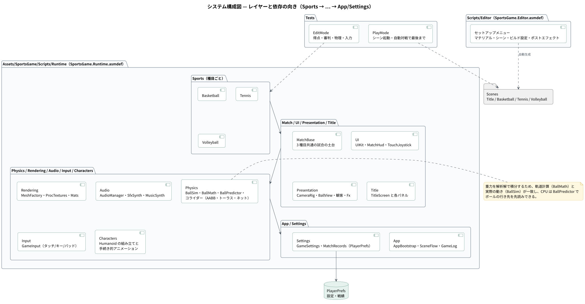
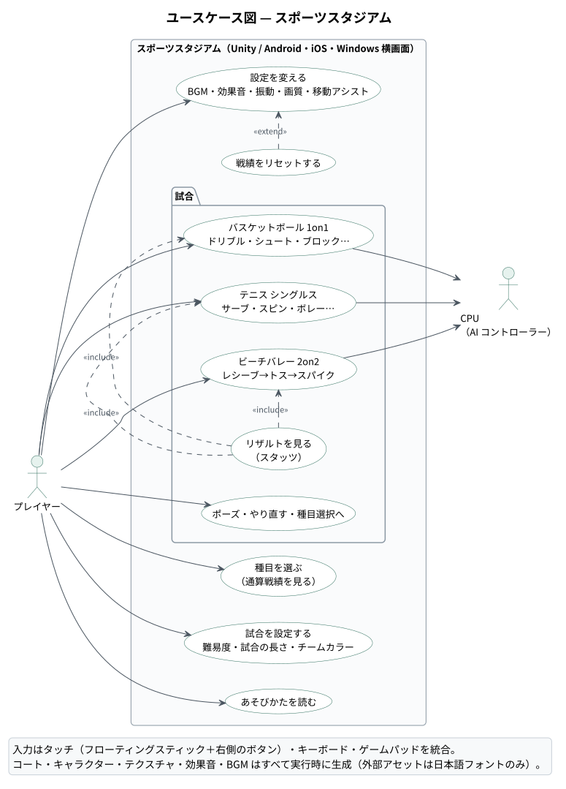
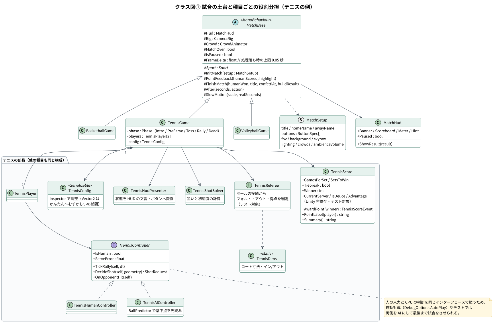
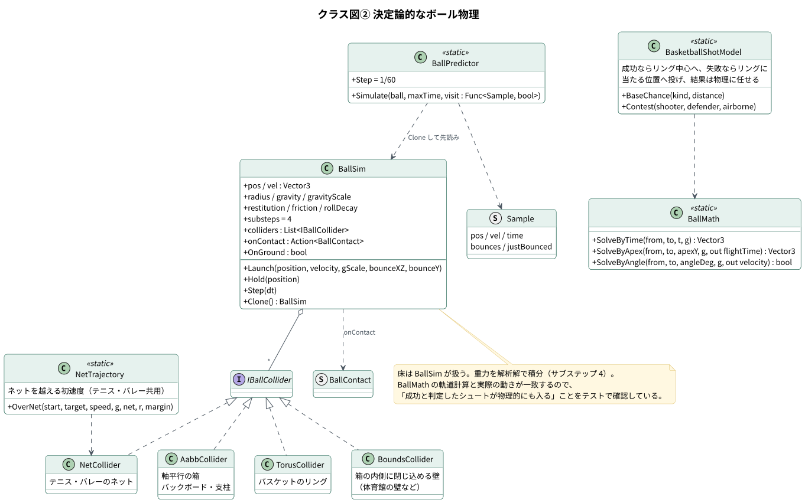
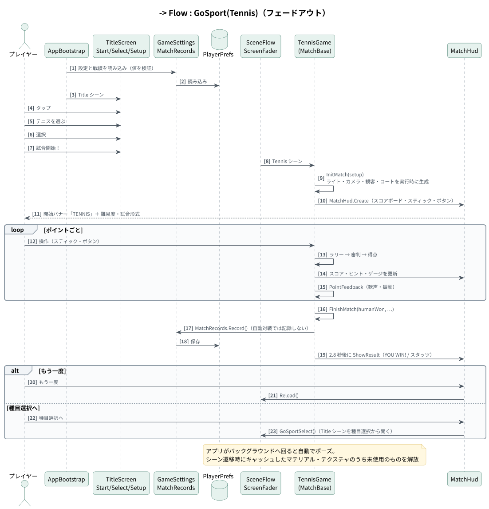
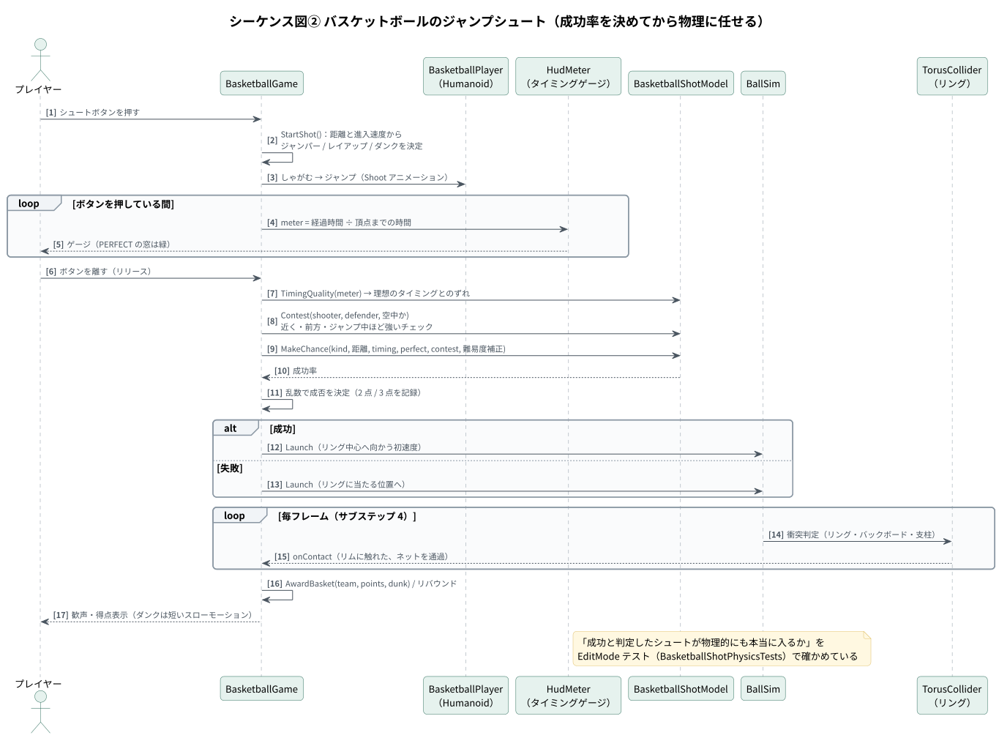
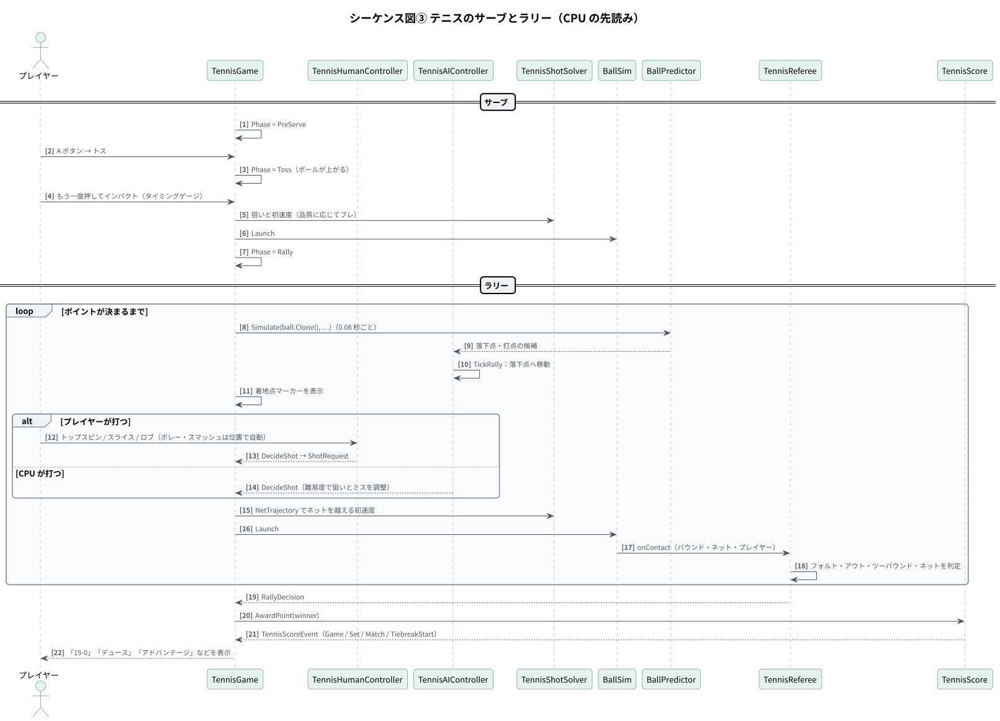
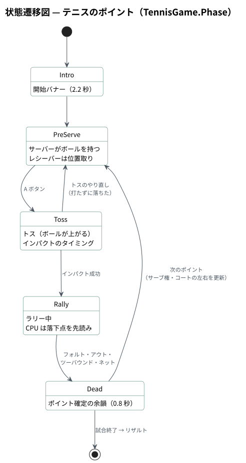

# 設計書 — スポーツスタジアム

1. [システム構成](#1-システム構成)
2. [種目ごとの役割分担](#2-種目ごとの役割分担)
3. [クラス図](#3-クラス図)
4. [シーケンス図・状態遷移図](#4-シーケンス図状態遷移図)
5. [ボール物理の設計](#5-ボール物理の設計)
6. [手続き的生成（アセットを持たない）](#6-手続き的生成アセットを持たない)
7. [データ設計](#7-データ設計)
8. [ディレクトリ構成](#8-ディレクトリ構成)

図の PlantUML ソースは [`diagrams/src/`](diagrams/src/)、SVG は [`diagrams/svg/`](diagrams/svg/) にあります。

---

## 1. システム構成



| 項目 | 内容 |
|---|---|
| エンジン | Unity 6000.6 / URP 17.6 / Input System 1.20 / uGUI 2.6 |
| アセンブリ | `SportsGame.Runtime` / `SportsGame.Editor` / `SportsGame.Tests.EditMode` / `SportsGame.Tests.PlayMode` |
| 依存の向き | `Sports → Match / UI / Presentation → Physics / Rendering / Audio / Input → App / Settings`（一方向） |
| 対象 | Android（IL2CPP / ARM64）・iOS・Windows。横画面固定 |
| 外部アセット | 日本語フォント（M PLUS Rounded 1c、SIL OFL）のみ |

### ユースケース



---

## 2. 種目ごとの役割分担

3 種目とも同じ構成でクラスを分けています（テニスの例）。

| 役割 | クラス | 内容 | Unity 依存 |
|---|---|---|---|
| 寸法・判定 | `TennisDims` | コート寸法、イン／アウト、ネットの生成 | あり |
| 得点 | `TennisScore` | ポイント・ゲーム・セット・サーブ権・デュース・タイブレーク | **なし**（テスト対象） |
| 審判 | `TennisReferee` | ボールの接触からフォルト・レット・アウト・ツーバウンド・得点を判定 | あり（テスト対象） |
| 打球 | `TennisShotSolver` | 狙いと初速度の計算 | あり |
| 操作 | `ITennisController` / `TennisHumanController` / `TennisAIController` | 人の入力と CPU の判断を同じインターフェースで扱う | あり |
| 表示 | `TennisHudPresenter` | 状態を HUD の文言・ボタンへ変換 | あり |
| 調整値 | `TennisConfig` | Inspector で変更できるパラメータ。`Vector2` は（かんたん, むずかしい）で難易度に応じて補間 | あり |
| 進行 | `TennisGame`（`MatchBase` を継承） | 状態遷移と各部品の連携 | あり |

`MatchBase` は 3 種目に共通する試合の土台（カメラ・HUD・観客・音・得点時の演出・試合終了の流れ・スローモーション）を持ち、各種目はルールと操作だけを実装します。

---

## 3. クラス図

### 3-1. 試合の土台と種目ごとの役割分担



### 3-2. 決定論的なボール物理



---

## 4. シーケンス図・状態遷移図

### 4-1. 起動から試合終了まで



### 4-2. バスケットボールのジャンプシュート



### 4-3. テニスのサーブとラリー



### 4-4. テニスのポイントの状態遷移



---

## 5. ボール物理の設計

Unity の物理エンジン（PhysX）を使わず、**自前の決定論的なボール物理**を実装しています。

| 設計 | 理由・効果 |
|---|---|
| 重力を解析解で積分（サブステップ 4） | `BallMath` の軌道計算と `BallSim` の実際の動きが一致する。「この初速度で投げればリングに届く」が計算どおりになる |
| `BallSim.Clone()` ＋ `BallPredictor.Simulate()` | CPU が 1/60 秒刻みで先読みし、落下点・打点を予測して動ける |
| 当たり判定は `IBallCollider` の小さな実装 | リング（トーラス）・バックボードと支柱（AABB）・体育館の壁（内側に閉じ込める箱）・ネット。種目ごとに必要なものだけ登録 |
| シュートは「成否を決めてから物理に任せる」 | 成功率（距離・タイミング・ディフェンスのチェック・難易度）で成否を決め、成功ならリング中心へ、失敗ならリングに当たる位置へ投げる。見た目は物理どおりで、ゲームバランスは確率で制御できる |
| フレーム時間の上限 0.05 秒 | 処理落ちしてもボールがすり抜けない |

「成功と判定したシュートが物理的にも本当に入るか」を、距離 5 通り × 角度の組み合わせで EditMode テストしています（`BasketballShotPhysicsTests`）。

---

## 6. 手続き的生成（アセットを持たない）

| 対象 | 実装 |
|---|---|
| コート・ゴール・ネット・観客席 | `MeshFactory` / `MeshBuilder` / `*CourtBuilder` / `StandsBuilder` でメッシュを生成 |
| テクスチャ | `ProcTextures`（木の床・ノイズ・グリッド・ネットの網目・ぼかし）、`BallPatterns`（種目ごとのボールの模様）、`UISprites`（UI の角丸やアイコン） |
| キャラクター | `HumanoidBuilder` で人型を組み立て、`HumanoidPose` で手続き的にアニメーション（シュート・レイアップ・ダンク・スマッシュ…） |
| 効果音・BGM | `SfxSynth` / `MusicSynth` / `Dsp` で波形を合成 |
| マテリアル | `Mats` でキャッシュし、シーン遷移時に未使用のアセットを解放 |
| セットアップ | エディタのメニュー **SportsGame > Setup Project** がマテリアル・ポストエフェクト・4 シーン・ビルド設定・プレイヤー設定を自動生成 |

---

## 7. データ設計

端末内の `PlayerPrefs` にだけ保存します（通信なし）。読み込み時に値を検証し、範囲外の値は既定値に戻します。

| 区分 | 項目 | 型 | 既定値 |
|---|---|---|---|
| 試合設定 | 難易度（`sg.diff`） | `Difficulty`（Easy / Normal / Hard） | Normal |
| 試合設定 | 試合の長さ（`sg.len`） | int（0〜2 に丸める） | 0 |
| 試合設定 | チームカラー（`sg.team`） | int（ブルー / グリーン / パープル / イエロー） | 0（ブルー） |
| 試合設定 | 選んだ種目（`sg.sport`） | `Sport` | Basketball |
| 設定 | BGM 音量（`sg.bgm`）・効果音 音量（`sg.se`） | float（0〜1 に丸め、NaN・無限大は既定値） | 0.55 / 0.9 |
| 設定 | 振動（`sg.vib`）・高画質（`sg.hq`）・移動アシスト（`sg.assist`） | bool | すべて ON |
| 戦績 | 種目ごとの勝ち数・負け数（`MatchRecords`） | int | 0（人が遊んだ試合だけ記録） |

---

## 8. ディレクトリ構成

```
Assets/SportsGame/
├── Resources/                 フォント(OFL)・ベースマテリアル・ポストエフェクト
├── Scenes/                    Title / Basketball / Tennis / Volleyball
├── Scripts/
│   ├── Runtime/               SportsGame.Runtime.asmdef
│   │   ├── App/               起動・シーン遷移・ログ・開発用オプション
│   │   ├── Settings/          種目情報・ユーザー設定・戦績(PlayerPrefs)
│   │   ├── Input/             タッチ/キーボード/ゲームパッドの統合入力
│   │   ├── Audio/             再生管理と波形合成(効果音・BGM)
│   │   ├── Physics/           決定論的なボール物理・軌道計算・先読み・コライダー
│   │   ├── Rendering/         マテリアル・メッシュ・手続き的テクスチャ
│   │   ├── Characters/        人型キャラクターの組み立てと手続き的アニメーション
│   │   ├── Presentation/      カメラ・ボール表示・観客席・演出
│   │   ├── UI/                UI キット・タッチ操作・試合 HUD
│   │   ├── Match/             3 種目共通の試合の土台(MatchBase)
│   │   ├── Title/             タイトル・種目選択・設定画面
│   │   └── Sports/            Basketball / Tennis / Volleyball
│   └── Editor/                セットアップ・ビルドメニュー
└── Tests/
    ├── EditMode/              得点・審判・物理・入力
    └── PlayMode/              シーン起動・自動対戦
```

C# 133 ファイル・約 11,000 行（`Assets/SportsGame`）。
