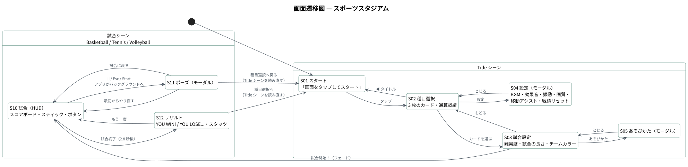
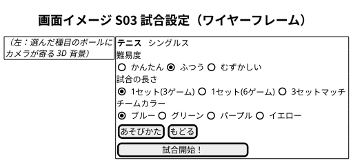

# 画面定義書 — スポーツスタジアム

| 項目 | 内容 |
|---|---|
| 対象 | スポーツスタジアム ver 1.0（Unity 6 / URP / Android・iOS・Windows） |
| 画面の向き | 横画面固定（UI の基準 1920×1080、`SafeArea` でノッチを避ける） |
| シーン | 4（Title・Basketball・Tennis・Volleyball） |
| 画面遷移図 | [diagrams/svg/screen-transition.svg](diagrams/svg/screen-transition.svg) |
| 共通仕様 | UI はすべてコード（`UIKit`）で生成。ボタン押下時は拡大縮小のアニメーションと効果音。モーダルは `ModalPanel` |

> **画面イメージについて**：S01 スタート・S02 種目選択・S10 試合（3 種目）は**実機のスクリーンショット**です。まだ撮影していない S03〜S05・S11・S12 は、**コードのレイアウトと文言から起こしたワイヤーフレーム**（PlantUML Salt。数値は例）で示しています。S01・S02・S10 のワイヤーフレームも、設計時の画面イメージとして [diagrams/svg/](diagrams/svg/) に残しています。

---

## 1. 画面一覧

| ID | 画面名 | シーン / 実装 | 種別 | 概要 |
|---|---|---|---|---|
| S01 | スタート | Title / `StartPanel` | 画面 | ロゴと「画面をタップしてスタート」 |
| S02 | 種目選択 | Title / `SelectPanel` | 画面 | 3 種目のカードと通算戦績 |
| S03 | 試合設定 | Title / `SetupPanel` | 画面 | 難易度・試合の長さ・チームカラー・試合開始 |
| S04 | 設定 | Title / `OptionsPanel` | モーダル | BGM・効果音・振動・画質・移動アシスト・戦績リセット |
| S05 | あそびかた | Title / `HowToPanel` | モーダル | 種目ごとの操作説明 |
| S10 | 試合 | Basketball / Tennis / Volleyball / `MatchHud` | 画面 | 3D の試合＋スコアボード・スティック・ボタン・ヒント |
| S11 | ポーズ | 試合 / `PauseMenu` | モーダル | 試合に戻る・やり直す・種目選択へ |
| S12 | リザルト | 試合 / `ResultPanel` | モーダル | 勝敗・スコア・スタッツ・もう一度 |

---

## 2. 画面詳細

### S01 スタート

ワイヤーフレーム：[wf-01-start.svg](diagrams/svg/wf-01-start.svg) ／ 背景のみ：[00-title-stage.jpg](screenshots/00-title-stage.jpg)

| No | 項目 | 種別 | 内容 |
|---|---|---|---|
| 1 | 背景 | 3D | 台座の上でゆっくり回る 3 種目のボールと、リングを描いた床（`TitleBackdrop`）。台座の天面は種目のテーマカラー。カメラは左右にゆっくり揺れる |
| 2 | ロゴ | テキスト | 「SPORTS STADIUM」（金色・縁取り・影） |
| 3 | サブタイトル | テキスト | 「スポーツスタジアム ～ バスケ・テニス・バレー ～」 |
| 4 | 画面をタップしてスタート | テキスト（点滅） | 画面のどこをタップしても S02 へ |
| 5 | バージョン | テキスト | 右下に「ver 1.0」 |

---

### S02 種目選択

ワイヤーフレーム：[wf-02-select.svg](diagrams/svg/wf-02-select.svg)

| No | 項目 | 種別 | 内容 |
|---|---|---|---|
| 1 | ◀ タイトル | ボタン | S01 へ |
| 2 | 種目をえらぼう | 見出し | |
| 3 | 設定 | ボタン | S04 を開く |
| 4 | 種目カード × 3 | ボタン | ボールのアイコン・種目名・形式（1on1 ハーフコート／シングルス／ビーチ 2on2）・**通算 n勝 n敗**・▶ プレイ。色は種目のテーマカラー（オレンジ／グリーン／ブルー） |

---

### S03 試合設定

| No | 項目 | 種別 | 選択肢 | 内容 |
|---|---|---|---|---|
| 1 | 背景 | 3D | — | 選んだ種目のボールにカメラが寄り、ボールが浮き上がって速く回る。右に設定パネルが出るので、ボールは画面の左寄りに映す |
| 2 | 種目名 | 見出し | — | テーマカラーの帯 |
| 3 | 難易度 | セグメント | かんたん／ふつう／むずかしい | CPU の強さ・反応速度・ミス率などを補間 |
| 4 | 試合の長さ | セグメント | バスケ：11点先取／21点先取／3分間 テニス：1セット(3ゲーム)／1セット(6ゲーム)／3セットマッチ バレー：1セット(15点)／1セット(21点)／3セットマッチ | |
| 5 | チームカラー | セグメント | ブルー／グリーン／パープル／イエロー | ユニフォーム・HUD・バスケのコートに反映。選んでいない色は暗く表示 |
| 6 | あそびかた | ボタン | — | S05 |
| 7 | もどる | ボタン | — | S02 |
| 8 | 試合開始！ | ボタン | — | 設定を保存し、フェードして試合シーンへ |

| 業務ルール |
|---|
| 選択はその場で `GameSettings` に保存する（次回も同じ設定で始められる） |

---

### S04 設定 ／ S05 あそびかた

| No | 項目 | 種別 | 内容 |
|---|---|---|---|
| 1 | BGM 音量 ／ 効果音 音量 | スライダー | 0〜100% |
| 2 | 振動 | ON / OFF | 得点時などのバイブレーション |
| 3 | 画質 | 高画質 / 省電力 | 高画質：影・観客の密度・パーティクル量を上げ、ポストエフェクト（トーンマッピング・ブルーム・色調補正・ビネット）を有効化 |
| 4 | 移動アシスト | ON / OFF | バレーで、自分が触る番にスティックを離していると、ボールに触れる位置へ自動で寄る |
| 5 | 戦績をリセット | ボタン（2 回押し） | 誤操作防止のため 1 回目は「もう一度押すとリセット」、2 回目でリセットして種目カードの表示も更新 |
| 6 | とじる | ボタン | 設定を保存して S02 へ |
| 7 | （S05）あそびかた | テキスト | 種目ごとの操作説明（`HowToTexts`） |

---

### S10 試合

<table>
<tr>
<td width="33%"></td>
<td width="33%"></td>
<td width="33%"></td>
</tr>
<tr>
<td align="center">バスケットボール（守備時）</td>
<td align="center">テニス</td>
<td align="center">ビーチバレー（相手の攻撃時）</td>
</tr>
</table>

ワイヤーフレーム：[wf-10-match-hud.svg](diagrams/svg/wf-10-match-hud.svg)

| No | エリア | 項目 | 内容 |
|---|---|---|---|
| 1 | 左上 | スコアボード | YOU / CPU の 2 段。チームカラー・補足（セットの履歴など）・メインスコア・サーブ権の点。下に情報行（バスケ「11点先取 ・ 3Pは3点」、テニス「セット 1 ・ 3ゲーム先取」「デュース」「タイブレーク (7ポイント先取)」、バレー「第1セット ・ 15点先取」など）。テニスは小さい数字がゲーム数、枠の数字がポイント |
| 2 | 右上 | II（ポーズ） | S11。Esc・ゲームパッドの Start でも開く |
| 3 | 中央 | 3D のコート | 選手・ボール・観客席・着地点マーカー |
| 4 | 中央 | バナー | 開始時（種目名＋難易度・試合形式）、得点・GAME SET など |
| 4' | 中央上 | センター表示 | バスケのショットクロック（12 秒。残り 5 秒以下で赤） |
| 5 | 選手の横 | タイミングゲージ | バスケのジャンプシュート・テニスのサーブ。PERFECT の窓は緑 |
| 6 | 下中央 | ヒント | 状況に応じた操作のヒント（例：CPU がボールを持っているとき「B でスティール / A でブロック」） |
| 7 | 左下 | スティック | 画面左側のどこをドラッグしても出るフローティングスティック |
| 8 | 右下 | アクションボタン | 種目ごとに下表 |

| 種目 | ボタン（A / B / C） | キーボード | ゲームパッド |
|---|---|---|---|
| バスケットボール | 攻撃：シュート ／ クロス ／ ダッシュ　守備：ブロック ／ スティール ／ ダッシュ　ルーズボール：ジャンプ ／ ダッシュ | J(Space) / K / L | South / East / West |
| テニス | トップスピン ／ スライス ／ ロブ（ボレー・スマッシュは打点の高さとバウンドの有無で自動） | 同上 | 同上 |
| バレーボール | サーブ前：トス → サーブ　レシーブ側：レシーブ（トス） ／ ジャンプ（相手の攻撃時はブロック）　攻撃：フェイント ／ スパイク | 同上 | 同上 |

| 業務ルール |
|---|
| アプリがバックグラウンドへ回ると自動でポーズ |
| 処理落ちしてもボールがすり抜けないよう、1 フレームの時間に上限（0.05 秒）を設ける |
| ダンク・スマッシュなど決定的な瞬間は短いスローモーション |
| 試合終了の 2.8 秒後に S12 |

---

### S11 ポーズ ／ S12 リザルト

 

| 画面 | No | 項目 | 内容 |
|---|---|---|---|
| S11 | 1 | 試合に戻る | ポーズを解除 |
| S11 | 2 | 最初からやり直す | シーンを読み直す |
| S11 | 3 | 種目選択へ戻る | Title シーンを読み直し、スタート画面を飛ばして種目選択（S02）から始める（`SceneFlow.GoSportSelect`） |
| S12 | 1 | リボン | 「YOU WIN!」／「YOU LOSE...」（勝ちは紙吹雪とジングル） |
| S12 | 2 | スコア | 例：「YOU  6-4  CPU」 |
| S12 | 3 | スタッツ | テニス：獲得ポイント・サービスエース・ウィナー・ミス・ダブルフォルト・1stサーブ成功率・最長ラリー・難易度。バスケ：ダンク・スティール など。バレー：ブロック決定 など |
| S12 | 4 | もう一度 ／ 種目選択へ | 同じ設定で再戦 ／ Title シーンを読み直し、種目選択（S02）から始める |

| 業務ルール |
|---|
| 通算戦績（`MatchRecords`）は**人が遊んだ試合だけ**記録する（自動対戦・テストでは記録しない） |
