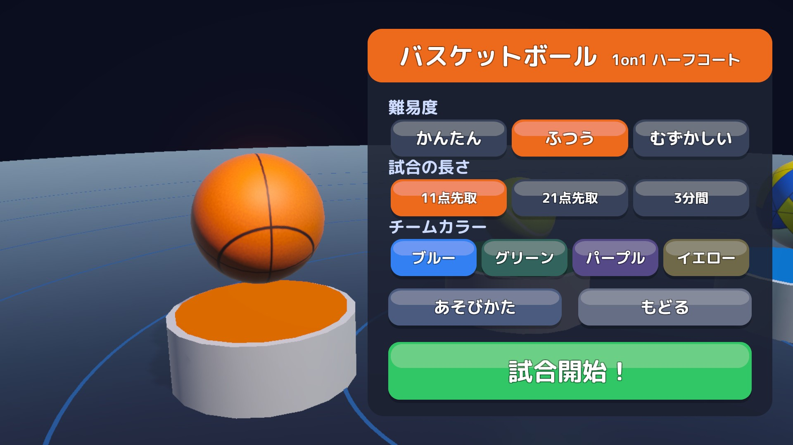
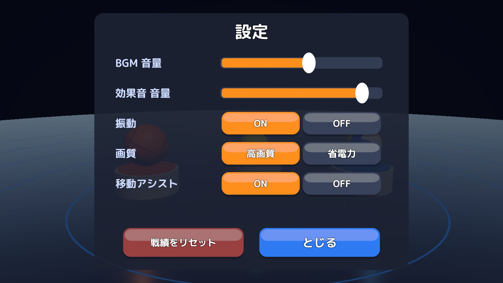
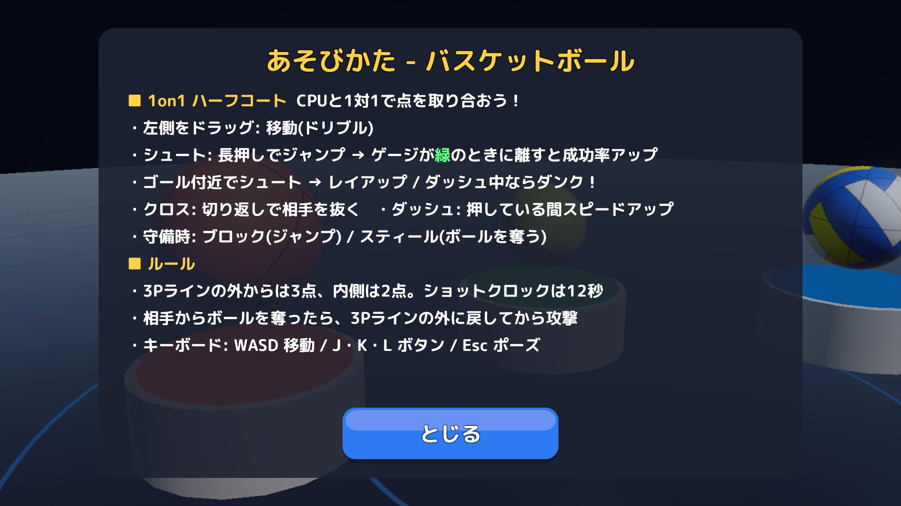
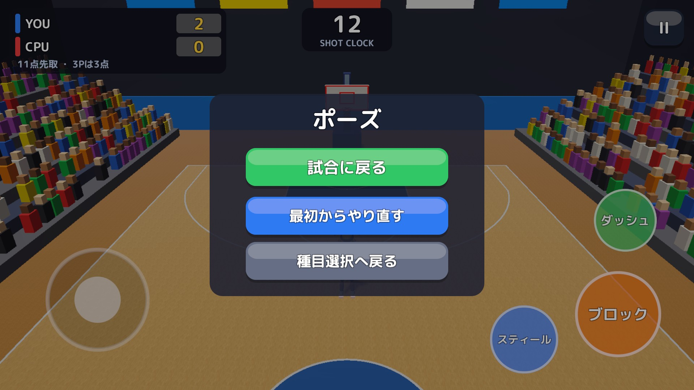
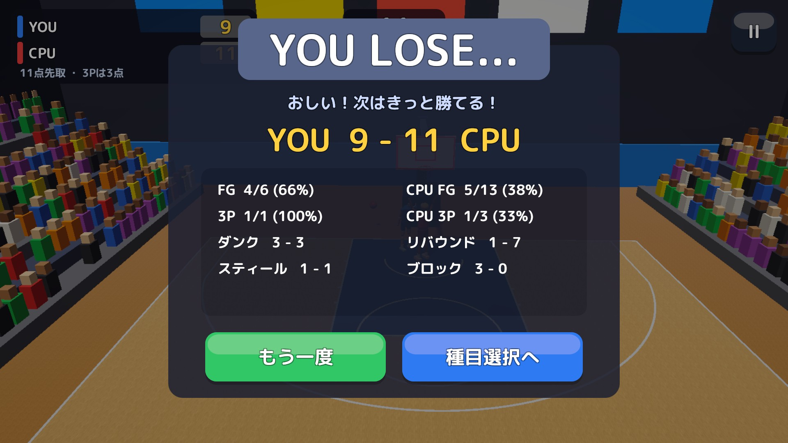

# スクリーンショット

主要画面のスクリーンショットです（1920×1080）。画面ごとの表示項目・操作は[画面定義書](../screen-definitions.md)を参照してください。

| ファイル | 画面 | 見どころ |
|---|---|---|
| [`01-start.jpg`](01-start.jpg) | S01 スタート | ロゴと「画面をタップしてスタート」。背景は 3D のタイトルステージ |
| [`00-title-stage.jpg`](00-title-stage.jpg) | タイトルの 3D ステージ（UI なし） | 台座・床・リング、ボールの模様まで、すべて実行時にコードで生成（`TitleBackdrop`・`ProcTextures`） |
| [`02-select.jpg`](02-select.jpg) | S02 種目選択 | 種目のテーマカラーのカードと通算戦績 |
| [`03-setup.jpg`](03-setup.jpg) | S03 試合設定 | 難易度・試合の長さ・チームカラーを選ぶ。背景は選んだ種目のボールにカメラが寄る |
| [`04-options.jpg`](04-options.jpg) | S04 設定 | BGM・効果音の音量、振動、画質、移動アシスト、戦績のリセット |
| [`05-howto.jpg`](05-howto.jpg) | S05 あそびかた | 種目ごとの操作とルールの説明（バスケットボールの例） |
| [`10-basketball.jpg`](10-basketball.jpg) | S10 試合（バスケットボール） | ダンクを決めた直後（「DUNK!!」のバナー）。ショットクロックと、状況で変わるボタン（ジャンプ／ダッシュ。スティールはこの場面では押せない） |
| [`11-tennis.jpg`](11-tennis.jpg) | S10 試合（テニス） | ゲーム数とポイントのスコアボード、サーブ権の点、トップスピン／スライス／ロブ |
| [`12-volleyball.jpg`](12-volleyball.jpg) | S10 試合（ビーチバレー） | 2on2、サーブ権の点、レシーブ／ジャンプのボタン |
| [`20-pause.jpg`](20-pause.jpg) | S11 ポーズ | 試合に戻る・最初からやり直す・種目選択へ戻る |
| [`21-result.jpg`](21-result.jpg) | S12 リザルト | 勝敗・スコア・スタッツ（YOU LOSE... の例）。「種目選択へ」で種目選択に戻る |

<table>
<tr>
<td width="50%"></td>
<td width="50%"></td>
</tr>
<tr>
<td width="50%"></td>
<td width="50%"></td>
</tr>
<tr>
<td width="50%"></td>
<td width="50%"></td>
</tr>
<tr>
<td width="50%"></td>
<td width="50%"></td>
</tr>
<tr>
<td width="50%"></td>
<td width="50%"></td>
</tr>
<tr>
<td width="50%"></td>
</tr>
</table>
